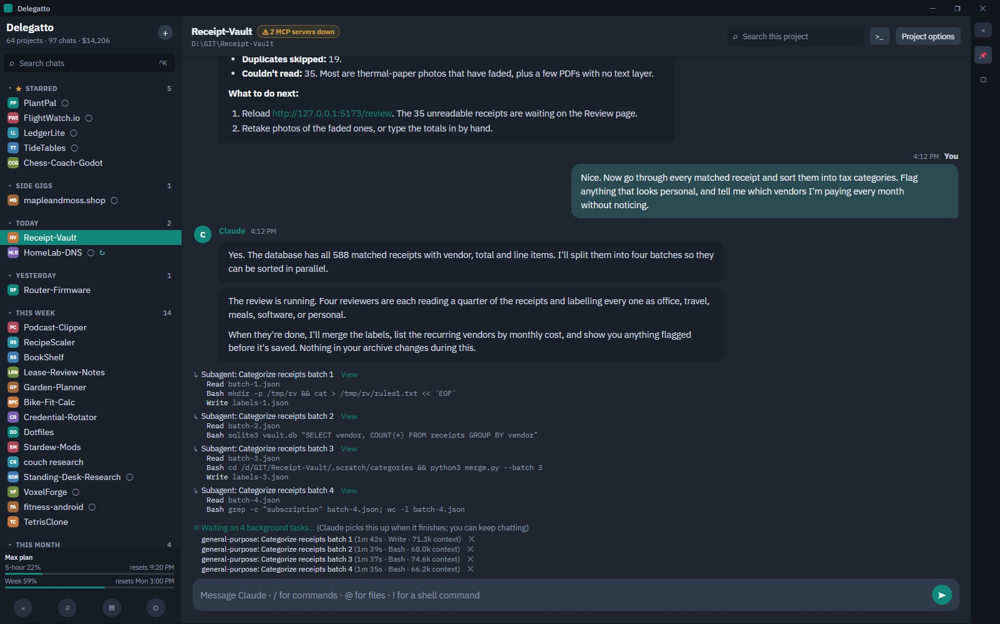

# Delegatto

A new UI/UX experience for Claude Code on Windows. Every project in one list, every conversation a click away, and no terminal required.



> Delegatto is an independent, unofficial project with no connection to Anthropic. Anthropic doesn't make, sponsor, endorse, or support it. Claude and Claude Code are trademarks of Anthropic.

## Features

- Every project and chat in one list, found automatically, with favorites, groups, custom names and icons
- Split view, with two, three or four chats side by side that you can drag to rearrange
- Live replies, with Claude's thinking, tool calls and subagents as they happen
- Search across every conversation you've ever had (Ctrl+K)
- Skills, slash commands, `@` file mentions and `!` shell commands, typed anywhere in a message
- Per-project settings: model, effort, permission mode, whether thoughts and tool calls show, next-prompt suggestions, extra folders, and Claude Code's own settings for just that project
- Permission, plan and question cards you answer with a click
- Project syncing across your PCs through a private GitHub repo you own, encrypted
- Project backup and restore, plus a cleanup screen for Claude Code's history
- Shows your plan usage, or your API cost and tokens, with an optional spending cap
- Theme it to your liking: built-in themes including a Terminal look, your own colors and fonts, and themes you can import and share
- Pin messages, rewind a chat, fork it, or ask a side question with `/btw`
- Desktop notifications, quiet hours and a system tray mode
- Works alongside Claude in the terminal, and shows its messages as they arrive
- Edit `CLAUDE.md`, memory, MCP servers, hooks, plugins and Claude Code settings from the app
## Getting started

1. Install [Claude Code](https://docs.claude.com/en/docs/claude-code) and sign in. Your chats run through it, on your own plan or API key.
2. Download Delegatto from the [Releases page](https://github.com/niftiest/Delegatto/releases): **Setup** to install it, or **Portable** to run it as a single file.
3. Open it. Your projects and chats appear on their own.

Runs on Windows 10 and 11.

> The first time you run it, Windows may say "Windows protected your PC" because Delegatto isn't signed with a certificate yet. Click **More info**, then **Run anyway**.

## Additional notes

- Your data stays on your PC. Delegatto has no account, no tracking and no server of its own. It only goes online to check GitHub for new versions, and to sync projects if you turn that on (or to make AI images, if you add your own image-service key). Claude Code itself talks to Anthropic as it always does.
- Chats from claude.ai or the Claude desktop app aren't stored on your PC, so they don't appear.

## For developers

Delegatto is open source. To run it from source, you'll need Node.js 22 or newer:

```
npm install
npm run dev
```

## License

[MIT](LICENSE)
